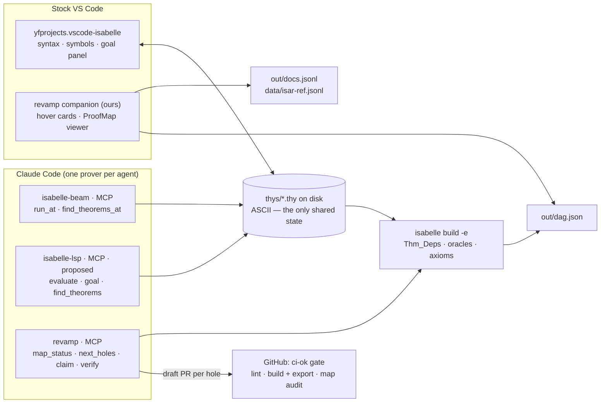

# isabelle-revamp

**Keep Isabelle/HOL's logic exactly as it is — and make it pleasant and agent-ready from modern tools.**

Isabelle is excellent at the research and logic level. It integrates poorly with other apps and systems, so it is hard to modify, looks dated, and has little agent support. This hackathon project fixes the **integration** and leaves the kernel, HOL and Isar untouched.

## What we build

| | Component | What it does | Status |
|---|---|---|---|
| 🃏 | **Hover cards** | Lean-style Markdown cards in stock VS Code: statement, doc with its source, breadcrumb, `File.thy:N`. No new syntax. | 🟡 planned — [plan](docs/plans/vscode-companion.md) |
| 🗺️ | **ProofMap** | A theorem dependency graph whose edges and statuses come from what the kernel recorded (`Thm_Deps`, `sorry` = the `skip_proof` oracle). Viewer inside VS Code. | 🟢 prototype on `proto/proofmap` · viewer [plan](docs/plans/vscode-companion.md) |
| ⚡ | **Beam** | Speculative `run_at` / `find_theorems_at` agent tools over MCP: try 16 candidate proofs without touching the file. | 🟢 prototype on `proto/beam` |
| 🤖 | **Agent loop** | Claude closes `sorry` holes: one hole → one draft PR → kernel batch build + map audit → a human merges. | 🟡 planned |
| 🛡️ | **CI gate** | `ci-ok`: lint, Isabelle build + export, map audit, agent lint. Nothing an agent writes reaches `main` without the kernel. | 🟢 prototype on `proto/ci` |
| 📚 | **Docs index** | Docstrings from `\<^marker>`, adjacent `text ‹›` and `\<comment>`, plus the Isar reference manual, as `docs.jsonl`. | 🟢 prototype in [`tools/prototypes/`](tools/prototypes) |
| 🔌 | **Isabelle-MCP** | Headless prover interface for agents (evaluate, goal, `find_theorems`, hover). | 🔵 proposed — [plan](docs/plans/isabelle-mcp.md) |

## How it fits together

Same kernel, same HOL, same Isar. Everything we add sits outside: an editor companion built on standard VS Code APIs, a kernel-checked export, and headless agent endpoints.

## Start here

- **[PLAN.md](PLAN.md)** — system design, contracts, git workflow, CI, workstreams, the 24-hour timeline and the first issues.
- **[docs/plans/](docs/plans)** — per-workstream plans awaiting approval: [VS Code companion (#9, #10)](docs/plans/vscode-companion.md), [Isabelle-MCP](docs/plans/isabelle-mcp.md).
- **[AGENTS.md](AGENTS.md)** — the rules every human and agent working in this repo follows.

## Team

| | Role |
|---|---|
| **Alex Hyman** · [@hymanimy](https://github.com/hymanimy) | maths, Isabelle, design, pitch |
| **ark** · [@sh-arka22](https://github.com/sh-arka22) | repo, CI, ProofMap and the editor |
| **retinapeg** · [@retinapeg](https://github.com/retinapeg) | agent endpoints, natural-language tools, onboarding |

## Ground rules

- Every change goes through a pull request. Never merge `main` into a branch: rebase instead.
- We integrate every ~45 minutes (the "train", see [PLAN.md §8](PLAN.md#8-git-workflow)).
- We never change Isabelle's kernel, HOL, Isar syntax or keywords.
- `.thy` files stay ASCII on disk; editors render the symbols.

## Credits and prior art

- [Prove2Me](https://prove2.me) (Lean) and [leanblueprint](https://github.com/PatrickMassot/leanblueprint) inspired ProofMap's dependency-graph workflow. We have no affiliation with either.
- [PIDE MCP](https://github.com/kappelmann/isabelle-pide-mcp) (LGPL-3.0) is the base for Beam.
- [Isabelle-MCP](https://github.com/xqyww123/Isabelle-MCP) (LGPL-2.1-or-later, Qiyuan Xu): a headless Isabelle MCP server, proposed as the agents' interface for evaluation and queries; see [docs/plans/isabelle-mcp.md](docs/plans/isabelle-mcp.md).
- [vscode-isabelle by yfprojects](https://github.com/real-yfprojects/vscode-isabelle) (BSD-3-Clause) is the editor extension we build alongside.
- Lean Beam's `runAt` inspired our `run_at` tool.
