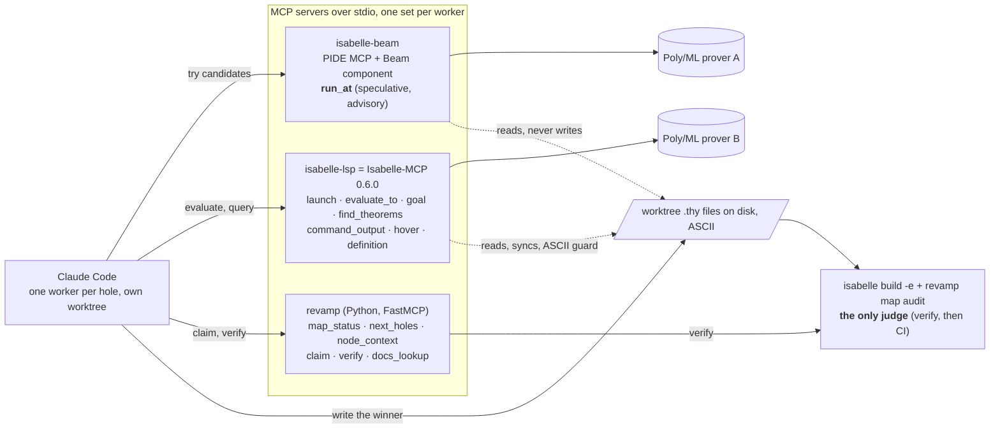

# Isabelle-MCP for isabelle-revamp: evaluation and integration plan

> [!IMPORTANT]
> **Status: proposal** for approval by retinapeg (WS-A owner) and ark, in PLAN.md §11 "plan first" mode: nothing here is implemented yet. The decision goes into `docs/decisions/ADR-0007-isabelle-mcp.md` once taken.
> **Subject:** [xqyww123/Isabelle-MCP](https://github.com/xqyww123/Isabelle-MCP) · PyPI `isabelle-mcp` 0.6.0 · LGPL-2.1-or-later · Isabelle2025-2 only. **Date:** Sat 17 Oct 2026.

---

## 0. Summary and recommendation

Isabelle-MCP is a headless, pip-installable MCP server that drives Isabelle2025-2 for one agent at a time: the agent edits `.thy` files on disk and calls tools to evaluate them and query goals, output, `find_theorems`, hover and definitions. It needs **no compilation and no Isabelle patch** (it ships a prebuilt Scala component, `isabelle mcp_server`, with `no_build = true`).

It does **not** give us speculative `run_at` (its `after_text` parameter is a position anchor, not candidate text), and it has **no sledgehammer tool**. It therefore does not replace Beam. It does replace the parts of PIDE MCP that Beam was going to inherit for *perception* (`get_state`, `find_entities`, sessions) and it is a far better **S3 fallback** than "edit-then-check through PIDE MCP", because it is installable in two commands and documented end to end.

| At a glance | Beam (PIDE MCP + our Scala) | Isabelle-MCP |
|---|:-:|:-:|
| Speculative `run_at`, file untouched, 16 candidates in parallel | ✅ ours | ❌ |
| Goal at a position, `find_theorems`, hover, definition | via PIDE MCP | ✅ |
| Prover-reported `sorry` / error / running lines per file | ❌ | ✅ |
| Sledgehammer tool | ✅ (PIDE MCP) | ❌ |
| Compile on every machine | ❌ needs `isabelle scala_build` | ✅ none (prebuilt jar) |
| Install | clone + components + build | `uv tool install isabelle-mcp` |

**Recommendation (option C, §2 of this document):**

1. Register Isabelle-MCP as a third MCP server, **`isabelle-lsp`**, next to `isabelle-beam` and `revamp`, and make it the agent's standard interface for *perception and edit-then-check*: `isabelle_launch` → `isabelle_evaluate_to` → `isabelle_goal` / `isabelle_command_output` / `isabelle_find_theorems` / `isabelle_hover`.
2. Keep Beam for exactly one thing: speculative `run_at` (the demo's "8 candidates in about 1 s without touching the file"). `find_theorems_at` becomes optional in Beam because Isabelle-MCP has it.
3. Add spike **S7** (20 min, retinapeg, T+0:45–1:05): install Isabelle-MCP on the demo machine and check Demo. If S3 (Beam on 2025-2) fails, the agent loop runs entirely on Isabelle-MCP by edit-then-evaluate; the demo beat changes wording from "8 candidates in 1 s" to "tries candidates one by one, prover-checked".
4. `verify` and CI stay as they are: the kernel batch build plus `revamp map audit` remain the only judge. Isabelle-MCP verdicts, like Beam's, are advisory.

Nothing about ProofMap export, the hover cards, the viewer or the CI gate changes.

### Where it sits (option C)



---

## 1. What Isabelle-MCP is (verified against the repo at commit `66bfe29`, "Release 0.6.0")

| Fact | Value |
|---|---|
| Author, licence | Qiyuan Xu (`xqyww123`), **LGPL-2.1-or-later** |
| Repo created / last push | 2026-05-27 / 2026-09-07 (v0.6.0). 4 stars, 2 forks, single maintainer. PyPI: 11 releases, latest 0.6.0 (2026-09-07). Classifier "Development Status :: 3 - Alpha". |
| Language, runtime | Python ≥ 3.12 (FastMCP ≥ 3.2 < 4, `mcp`, pydantic 2, watchdog, beautifulsoup4). CI on ubuntu-latest, Python 3.12 and 3.13, unit tests only (integration tests need a prover). macOS is supported in code (watchdog uses FSEvents) but not exercised in CI. |
| Isabelle requirement | **Isabelle2025-2 only** (2024 dropped; tag `last-isabelle2024-support`). Matches our pin (ADR-0002). |
| Prover side | Own Scala component under `src/isabelle_mcp/scala/Isabelle2025-2/`: a fork of Isabelle's VSCode language-server sources plus new position-explicit PIDE requests. Ships a **prebuilt `lib/isabelle_mcp.jar`** with `no_build = true`; registered by appending one line to `$ISABELLE_HOME_USER/etc/components` on first launch (or by `isabelle-mcp install`). No heap is invalidated. `isabelle-mcp uninstall` removes the line. |
| Transport, concurrency | stdio; **one agent per server instance**, one prover session, one evaluation in flight. Not concurrency-safe by design. |
| Install | `uv tool install isabelle-mcp` (recommended: global `PATH`, own Python) then `isabelle-mcp install [--claude|--codex] [--name isabelle-lsp] [--isabelle-bin /path/to/bin/isabelle]`. Or manual: `claude mcp add -s user isabelle-lsp -- isabelle-mcp`. |
| Positions, paths | 1-indexed lines; absolute file paths (0.6.0 also resolves relative paths against the project root). Position-sensitive tools take a `symbol` or `after_text` snippet, never a column. |
| Files on disk | The server reads the files the agent edits (a watcher syncs dependency files at every tool call). **ASCII guard:** a `.thy` with Unicode symbols is rewritten on disk to `\<alpha>` form when that yields pure ASCII; otherwise it is pushed unchanged with a warning. This enforces our ASCII rule rather than fighting it. |
| Sessions | `isabelle_launch(session, session_dirs, debug)` **never builds**: a missing heap fails in ~5 s with the exact `isabelle build -b …` command. The launched session must be the **parent** of the theories being edited (precompiled theories cannot be edited): for `thys/Apery` that is `HOL` with `session_dirs=[<repo>/thys]`; for `heavy/` it is the AFP parent (for example `Prime_Number_Theorem`). |
| Soundness of verdicts | `isabelle_evaluate_to` reports `clean`/`complete` only once forked proofs have joined; errors slow checking rather than stop it; a stuck command is cancelled with `isabelle_cancel_evaluation`. Only `isabelle_evaluate_to` evaluates; every query answers about already-evaluated lines and says why when it cannot ("not a proof operation", "has not finished evaluating"); nothing is concluded from a timeout. |

### 1.1 Tools (13 core + 11 ML-debugger tools; the debugger ones are irrelevant to us)

| Tool | Signature (from `server.py`) | What it gives us |
|---|---|---|
| `isabelle_launch` | `(session="Main", session_dirs=None, debug=False)` | start/restart the prover; idempotent for the same session |
| `isabelle_terminate` | `()` | stop the prover, keep the MCP server |
| `isabelle_evaluate_to` | `(file_path, line, after_text=None)`; `line=-1` = whole file | **evaluate**; returns a per-file snapshot of error lines, **`sorry` lines** and running/pending lines |
| `isabelle_evaluation_status` | `()` | poll the same snapshot |
| `isabelle_cancel_evaluation` | `()` | cancel a looping command |
| `isabelle_goal` | `(file_path, line, after_text=None)` | **the goal after the command at a position** (`PIDE/proof_state_at_position`). `after_text` anchors the position; it is not speculative text |
| `isabelle_find_theorems` | `(file_path, line, after_text, names, exclude_names, intro, elim, dest, solves, patterns, exclude_patterns, simp, exclude_simp, limit, allow_duplicates)` | Isabelle's `find_theorems` in the context at a position: = C4 `find_theorems_at` |
| `isabelle_command_output` | `(file_path, line, after_text=None)` | the enclosing command's source and its messages (writeln / warning / error / information) |
| `isabelle_command_status` | `(positions: [{file_path, line}])` | state of the commands covering each line |
| `isabelle_hover` / `isabelle_definition` / `isabelle_local_occurrences` | `(file_path, line, symbol)` | LSP hover (type + doc), definition, in-file occurrences |
| `isabelle_session_info` | `()` | session name and Isabelle version |

**Not provided:** speculative execution of candidate text (`run_at`), a sledgehammer tool (the Scala fork contains `vscode_sledgehammer.scala`, but no MCP tool exposes it), theorem dependencies (ProofMap stays on `isabelle build -e`), more than one session per process.

---

## 2. Isabelle-MCP versus the plan's Beam / PIDE MCP

| Capability (C4 name) | Beam = PIDE MCP + our Scala | Isabelle-MCP |
|---|---|---|
| `run_at` (speculative, file untouched, 16 candidates in parallel) | **yes**, our own code; S3 risk (4 ML API changes between 2025-2 and 2026) | **no**; edit-then-evaluate, one candidate at a time, PIDE re-checks only the changed command |
| `find_theorems_at` | our own code | `isabelle_find_theorems` (richer criteria) |
| `get_state` | PIDE MCP | `isabelle_goal` |
| `read` / `edit` | PIDE MCP tools | the agent edits files directly; the watcher syncs; ASCII guard |
| `sledgehammer` | PIDE MCP `tool_extensions` | **none**; workaround: write `sledgehammer` into the proof in the worktree, `evaluate_to` it, read `isabelle_command_output`, remove it |
| Prover-reported `sorry` lines, error lines, running lines | no | `isabelle_evaluate_to` snapshot |
| Hover / definition / occurrences | `find_entities` | yes (LSP) |
| Sessions | `start_session`/`stop_session`/`list_sessions` | one session; `launch`/`terminate` |
| Compilation on each machine | **yes** (`isabelle components -u beam/ext && isabelle scala_build`, plus PIDE MCP's own build) | **no** (prebuilt jar, `no_build = true`) |
| Isabelle version | 2025-2 (PIDE MCP branch `Isabelle2025-2`, SHA `7463338` in `deps.lock`) | 2025-2 only |
| Licence | LGPL-3.0 (PIDE MCP); our `beam/` is LGPL-3.0 | LGPL-2.1-or-later; used unmodified as a pip dependency, nothing vendored |
| Activity | PIDE MCP created 2026-06-11, pushed 2026-10-16, 19 stars | created 2026-05-27, pushed 2026-09-07, 4 stars |
| Docs and tests | upstream README | `docs/{SPECIFICATION,ARCHITECTURE,API_DESIGN,TECH_NOTE}.md`, CHANGELOG with design rationale, 44 test files, `mypy --strict`-style config |
| Agent guidance shipped | — | server instructions at the MCP handshake plus an `isabelle-command-line` skill |

### Options

| Option | What | Verdict |
|---|---|---|
| **A. Beam primary, Isabelle-MCP as S3 fallback only** | nothing changes unless S3 fails | safe, but leaves the agent's perception on PIDE MCP tools nobody has tested with Claude |
| **B. Replace Beam with Isabelle-MCP** | no Scala work; edit-then-evaluate for every candidate | loses the speculative demo beat and the parallel candidates; sledgehammer needs the workaround |
| **C. Isabelle-MCP for perception and checking, Beam for `run_at` only (recommended)** | two servers per agent; Beam shrinks to one tool | retinapeg's Scala surface shrinks to `run_at`; if S3 fails we are already running on Isabelle-MCP and only lose speed |

Cost of C: a second prover per agent when both servers are launched (about 2.2 GB RSS each). §6 of this document has the budget.

---

## 3. Changes to PLAN.md, by section (to apply only after approval)

| Section | Amendment |
|---|---|
| §5 architecture | Claude Code gets a third stdio server: `"isabelle-lsp"` = `isabelle-mcp` (Python), launched with `session=<parent>` and `session_dirs=[<wt>/thys]`. One Poly/ML prover per Isabelle-MCP instance. Beam keeps its own prover for `run_at`. |
| §6.1 C4 | Add server `isabelle-lsp` with the tools of §1.1 as they are (we do not wrap them). Beam's `find_theorems_at` becomes optional ("SHOULD"). The name is `isabelle-lsp`, not `isabelle`, for the same reason Beam is not called `isabelle` (a yfprojects build from `main` registers `isabelle`). |
| §6.1 `claim`, step 3 | Per-agent `HOME=<wt>/.isahome`: `claim` must register the Isabelle-MCP component in that home too (`isabelle-mcp install --isabelle-bin "$ISABELLE_HOME/bin/isabelle"` with `HOME=<wt>/.isahome`, or append the component line to `<wt>/.isahome/.isabelle/Isabelle2025-2/etc/components`), exactly as it re-runs `components -u` for Beam and PIDE MCP. The worktree's `.mcp.json` gets an `isabelle-lsp` entry with `"env": {"HOME": "<wt>/.isahome"}`. |
| §7 `deps.lock` | add `isabelle_mcp=0.6.0` (PyPI). `scripts/setup.sh` installs it with `uv tool install isabelle-mcp==0.6.0` and registers it with `isabelle-mcp install --claude --name isabelle-lsp`. `docs/DEPENDENCIES.md` lists LGPL-2.1-or-later, unmodified dependency. |
| §9 CI | No new required job. In the `beam` job (or `isabelle`, if Beam is cut), one smoke step: `uv tool install isabelle-mcp==0.6.0 && python3 beam/tests/isabelle_mcp_smoke.py` — launch `HOL -d thys`, evaluate `thys/Demo/Basics.thy` to the end, assert the snapshot lists the two `sorry` lines (13 and 19 in the current fixture) and `isabelle_goal` at line 12 shows one open subgoal. Budget ≤ 2 min warm. |
| §11 guardrails | Unchanged. Isabelle-MCP's own instruction text says "edit files and evaluate"; our SKILL.md still requires `run_at` first when Beam is present and forbids editing statements. |
| §11A perception | Perception now comes from Isabelle-MCP: `isabelle_goal`, `isabelle_command_output`, `isabelle_find_theorems`, `isabelle_hover`, `isabelle_definition`, the evaluation snapshot. `run_at` stays the speculative action. The ReAct loop's "all error or timeout → sledgehammer" step uses PIDE MCP's `sledgehammer` tool if Beam is present, else the workaround in §2 of this document. |
| §12 spikes | New spike **S7** (§5 of this document). Go/no-go at Train 4 decides A/B/C from the S3 and S7 results. |
| §13 issues | #7 Beam: acceptance keeps `run_at` and the smoke verdicts; `find_theorems_at` drops to SHOULD. #12 `revamp` MCP + SKILL.md: `.mcp.json.example` registers `isabelle-beam`, `isabelle-lsp` and `revamp`; `claim` registers the Isabelle-MCP component in the worktree home; SKILL.md documents the Isabelle-MCP loop of §4 of this document. #13 `setup.sh`: installs and registers Isabelle-MCP; `doctor.sh` checks `command -v isabelle-mcp` and that `etc/components` has exactly one Isabelle-MCP line. |
| §14 trade-offs | New row: "Isabelle-MCP for perception, Beam for `run_at`" versus "Beam alone" versus "Isabelle-MCP alone": chosen because it removes the untested PIDE MCP perception path and gives a tested fallback; revisit when Isabelle-MCP grows a speculative tool or sledgehammer, or when Isabelle2026 lands (Isabelle-MCP will need a 2026 component; it has a precedent: it dropped 2024 cleanly). |
| §15 risks | New rows: §7 of this document. |
| §16 glossary | **Isabelle-MCP / `isabelle-lsp`:** Qiyuan Xu's headless MCP server over a forked VSCode language server; one agent per instance; evaluates by file edits. |
| README credits | "[Isabelle-MCP](https://github.com/xqyww123/Isabelle-MCP) (LGPL-2.1-or-later) by Qiyuan Xu is the agent's prover interface for evaluation and queries." |

---

## 4. The agent loop with Isabelle-MCP (SKILL.md delta, one hole)

```
claim(id)                                  # revamp: draft PR = lock, worktree <wt>
node_context(id)                           # revamp: statement, nl, deps, used_by
isabelle_launch(session=<parent>, session_dirs=[<wt>/thys])      # isabelle-lsp, once per worktree
isabelle_evaluate_to(<wt>/thys/<S>/<T>.thy, line=<hole line>)    # evaluate up to the hole
isabelle_goal(file, <hole line>)           # the open goal; isabelle_command_output for errors
isabelle_find_theorems(file, <hole line>, patterns=[...], solves=True)   # premise retrieval (§11A)
loop r = 1..4:
  if isabelle-beam present:
      run_at(origin, line, candidates[<=16])                      # speculative, file untouched
      winner = first candidate with verdict proved
  else:
      for each candidate: write it, isabelle_evaluate_to(file, line) → poll isabelle_evaluation_status
                          until no running/pending; proved = no error line in the proof span and
                          the hole's sorry line is gone from the snapshot
  if winner: write it (if not already), isabelle_evaluate_to(file, -1) must be clean → verify(id) → PR
  else: refine from isabelle_goal / isabelle_command_output; sledgehammer (PIDE MCP tool, or the workaround)
after 4 rounds / 20 min / 2 strikes → needs-human
```

Rules that stay: `sorry` on its own line in stubs; ASCII escapes only (Isabelle-MCP's guard rewrites Unicode anyway, but the agent must not rely on it); never edit a statement; `verify` is the judge.

---

## 5. Spike S7: Isabelle-MCP on 2025-2 (retinapeg, 20 min, T+0:45–1:05, in parallel with S2/S3)

**Setup (from Isabelle-MCP's README/AGENTS.md; not yet run on our machines, which is what the spike is for):**

```bash
uv tool install isabelle-mcp==0.6.0          # or: pip install --user isabelle-mcp
isabelle-mcp install --claude --name isabelle-lsp \
  --isabelle-bin "$HOME/Isabelle2025-2/bin/isabelle"   # or wherever S0 put it
claude mcp list                               # isabelle-lsp listed
```

**Pass, all of:**
1. `isabelle_launch(session="HOL", session_dirs=["<repo>/thys"])` succeeds without building anything.
2. `isabelle_evaluate_to("<repo>/thys/Demo/Basics.thy", -1)` returns a snapshot that lists exactly the `sorry` lines 13 and 19 (the `sorry` tokens of `dbl_mono_open` and `dbl_pos`) and no error lines, with nothing running once polled to completion.
3. `isabelle_goal(..., line=12)` shows the open goal `m ≤ n ⟹ dbl m ≤ dbl n` (ASCII form acceptable).
4. `isabelle_find_theorems(..., line=12, patterns=["_ ≤ _"], limit=5)` returns ≥ 1 result.
5. After writing a proof over the `sorry` at line 13 (`by (simp add: dbl_def)` is expected to work; else `by (auto simp: dbl_def)`; Alex confirms the text) and re-evaluating, the snapshot no longer lists line 13 as a hole, and the `Basics.thy` on disk is still pure ASCII (`LC_ALL=C grep -nP '[^\x00-\x7F]' Basics.thy` prints nothing).
6. Memory: one `isabelle-mcp` session ≈ 2–3 GB RSS (record the number for §6 of this document).
7. Works on the demo machine (macOS arm64) and on one Linux machine.

**Fallback if S7 fails:** PLAN §12 S3's original fallback (PIDE MCP `get_state` and edit-then-check) stands, and Isabelle-MCP is dropped from `.mcp.json.example`. Record in ADR-0006.

**Decision matrix at Train 4 (T+3:00):**

| S3 (Beam) | S7 (Isabelle-MCP) | Choice |
|---|---|---|
| pass | pass | **C**: Beam `run_at` + Isabelle-MCP perception |
| fail | pass | **B**: Isabelle-MCP alone; demo wording changes; retinapeg's freed time goes to #12/#13 |
| pass | fail | **A**: Beam alone, PIDE MCP perception (original plan) |
| fail | fail | PIDE MCP edit-then-check (original S3 fallback) |

---

## 6. Resource budget (PLAN §3 and §11 numbers)

| Process | RSS |
|---|---|
| Editor's own prover (yfprojects) | ≈ 2.2 GB |
| Isabelle-MCP prover, per agent | ≈ 2.2 GB (S7 measures it) |
| Beam prover, per agent, only when `run_at` is used | ≈ 2.2 GB |
| `verify` / `export --watch` batch build | 2–4 GB |
| VS Code + Claude Code + JVMs | 1–2 GB |

On a **16 GB** machine with option C: k = 1 agent, both servers ≈ 10–12 GB peak while `verify` runs; acceptable only with `export --watch` paused during `verify` (already in the plan). If it is tight, launch Beam only for the `run_at` rounds and `isabelle_terminate` is not needed (Isabelle-MCP stays). On **32 GB**: k ≤ 2 with both servers, k ≤ 3 with Isabelle-MCP alone.

---

## 7. Risks specific to Isabelle-MCP (for PLAN §15)

| Risk | L / I | Mitigation → fallback |
|---|---|---|
| Alpha software, single maintainer, 4 stars, last release 7 Sep 2026 | M / M | Pin `0.6.0`; S7 before any dependence; original S3 fallback kept |
| Prebuilt jar we did not build | L / M | Sources are in the wheel (`scala/Isabelle2025-2/src`); if anyone objects, `isabelle scala_build` on a copy with `no_build` removed reproduces it (stretch); it runs only in agent worktrees, never in CI's gate |
| Component registration lives in `$ISABELLE_HOME_USER/etc/components` → one line per Isabelle home | M / L | `claim` registers it in each `<wt>/.isahome`; `doctor.sh` checks for exactly one line; `isabelle-mcp uninstall` on teardown |
| Python ≥ 3.12 (PLAN §0 asked for ≥ 3.10) | M / L | `uv tool install` brings its own interpreter; no change to `tools/` (still ≥ 3.10) |
| The ASCII guard rewrites files on disk | L / L | Only files the agent opens in its own worktree; our lint requires ASCII anyway; agents write escapes |
| One evaluation in flight; a looping candidate blocks the agent | M / M | `isabelle_cancel_evaluation` after a bounded poll (20 s per candidate in SKILL.md); Beam's `run_at` has its own 10 s timeout |
| `isabelle_launch` refuses to build; AFP parents for `heavy/` must be prebuilt | H / L | Already the plan: S4 builds the chain; `claim` copies ancestor heaps into the worktree home |
| No sledgehammer tool | M / M | PIDE MCP's `sledgehammer` through Beam; else the write-`sledgehammer`-and-read-output workaround |
| Isabelle2026 (24 Oct) | certain / L | Out of scope by ADR-0002; post-hackathon, both Beam and Isabelle-MCP need 2026 components |

---

## 8. Licensing

Isabelle-MCP is LGPL-2.1-or-later. We install it from PyPI and call it over stdio; we copy nothing, link nothing, and ship nothing of it in our vsix or wheel. No change to our BSD-3-Clause repo and no new directory with its own licence (unlike `beam/`, which is LGPL-3.0 because it modifies PIDE MCP). It goes into `docs/DEPENDENCIES.md` with the pinned version.

---

## 9. What is not affected

- **ProofMap** (export, statuses, audit, viewer): statuses still come from the kernel through `isabelle build -e` and `Thm_Deps`. Isabelle-MCP's `sorry`-line snapshot is a useful cross-check for the PLAN §6.2 lexical fallback, nothing more.
- **Hover cards and the VS Code companion:** they never call a prover. Post-hackathon only: Isabelle-MCP's position-explicit requests (`PIDE/proof_state_at_position`, `PIDE/theory_status`) are a worked example of how an Isar context pane could be served without moving the caret; add to PLAN §14's revisit list.
- **CI gate, `verify`, lockfiles, agent lint:** unchanged.

---

## 10. Open questions for the team

1. retinapeg: do you want option C, or B if S3 looks shaky by Train 3? (Decides how much Scala you write tonight.)
2. Alex: is the demo beat acceptable in its B wording ("Claude tries candidates one by one, each checked by the prover") if S3 fails?
3. ark: does `claim` register the component per worktree home, or do we give agents a shared `ISABELLE_HOME_USER` for components and keep only heaps per worktree? (The latter breaks the "no two builds clash" rule; recommended: per worktree.)
4. Should Beam's `find_theorems_at` be cut now (saves retinapeg one Scala file) given Isabelle-MCP's `isabelle_find_theorems`?

---

### Sources

- Isabelle-MCP README, AGENTS.md, `docs/API_DESIGN.md`, `pyproject.toml`, `src/isabelle_mcp/server.py` (tool signatures), `src/isabelle_mcp/instructions.py`, `src/isabelle_mcp/unicode_guard.py`, `src/isabelle_mcp/component.py`, CHANGELOG 0.6.0; GitHub and PyPI metadata read on 17 Oct 2026.
- PIDE MCP: https://github.com/kappelmann/isabelle-pide-mcp (metadata read on 17 Oct 2026); PLAN.md §6.1 for the Beam tool list.
