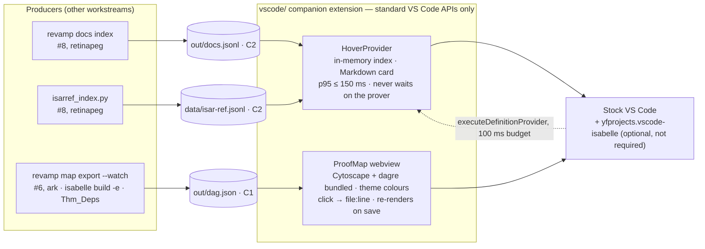
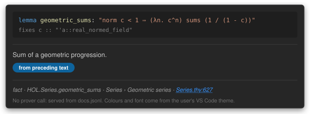
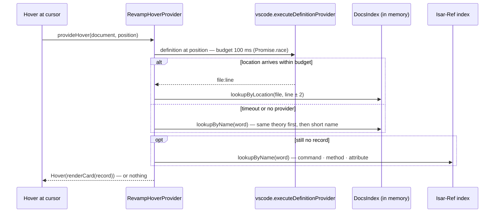
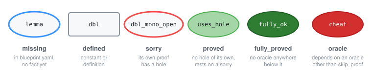

# VS Code companion extension: implementation plan for #9 (hover cards) and #10 (ProofMap viewer)

> [!IMPORTANT]
> **Status: proposal**, PLAN.md §11 "plan first": post as the issue bodies, a human approves (≤ 5 min), then one small PR per issue. (Extension code now exists at `extension/`; see the update note below.)
> **Update (after merging Leo's branch):** extension code now exists at `extension/` (M1–M9: goals sidebar, pretty symbols, swarm, ask, MCP bridge). Implement #9 and #10 **inside `extension/`** rather than a new `vscode/` directory; the scaffold, settings names and fixtures below apply with that path change.
> **Owner:** ark. **Reviewers:** Alex signs off the look from light/dark screenshots (PLAN §2); retinapeg owns the two inputs (`docs.jsonl`, `data/isar-ref.jsonl`). **Date:** Sat 17 Oct 2026.

> [!NOTE]
> **Numbering.** PLAN §13 assumed issues 1–20 would be created before any PR. PRs #1 and #2 already exist, so the GitHub issue for plan item 9 will not be #9. Below, "#9" and "#10" mean **plan items** 9 and 10; put the real issue numbers in "Closes #N".

---

## 0. What the extension is (PLAN §5, §6.3, §13)

A **companion** to the Marketplace `yfprojects.vscode-isabelle` (2026.10.0, verified live): it adds what Lean users have and Isabelle users do not — hover cards with docs, and a kernel-checked theorem dependency map — using **standard VS Code APIs only**. It never calls the prover, never patches Isabelle, has **no hard dependency on yfprojects**, and reads only two files produced by other workstreams:

| Input | Contract | Producer | Default path (setting) |
|---|---|---|---|
| `docs.jsonl` + `data/isar-ref.jsonl` | C2 (PLAN §6.3) | retinapeg, #8 (`revamp docs index`, `isarref_index.py`) | `out/docs.jsonl` (`revamp.hover.docsIndex`), `data/isar-ref.jsonl` (`revamp.hover.isarRefIndex`) |
| `dag.json` | C1 (PLAN §6.2) | ark, #6 (`revamp map export [--watch]`) | `out/dag.json` (`revamp.proofMap.dagPath`) |

Both producers are hours away, so the extension is built **against golden fixtures** first (PLAN §6: "consumers build against the golden examples, so they never wait for the producer"). Nothing in this plan needs an Isabelle installation.



---

## 1. Shared scaffold (lands with the PR for #9; #10 and #17 only add files)

```
vscode/
├── package.json            name isabelle-revamp · publisher isabelle-revamp · main dist/extension.js · engines.vscode ^1.99.0
├── package-lock.json       (CI: npm ci, cache key)
├── tsconfig.json           module node20 · target es2022 · lib es2022+dom (webview) · strict · noEmit
├── tsconfig.test.json      emits out/ for the e2e tests only
├── esbuild.mjs             two bundles: dist/extension.js (cjs, external vscode) and dist/webview.js + dist/webview-style.css (iife)
├── eslint.config.mjs       typescript-eslint recommended (flat config)
├── .vscode-test.mjs        workspaceFolder test/fixtures/workspace · --disable-extensions · short --user-data-dir (.vscode-test/ud)
├── .gitignore .vscodeignore
├── src/
│   ├── extension.ts        activate(): indexes → hover provider → commands → ProofMap; exports a small API for tests
│   ├── hover/  symbols.ts (\<sym> decoding) · index.ts (C2 records, lookups) · card.ts (Markdown card) · indexes.ts (load/watch) · provider.ts
│   ├── map/    dag.ts (C1 parse/validate, status counts, hole ranking) · protocol.ts (messages) · panel.ts (webview host) · webview/{main.ts, webview.css}
│   ├── util/   paths.ts (setting → URIs, watch, open file:line)
│   └── outline/            empty until #17
└── test/
    ├── unit/               mocha + tsx, no VS Code: symbols, index, card (golden), dag, ranking
    ├── e2e/                @vscode/test-cli: activation, hover on the fixture theory, ProofMap command
    ├── golden/*.md         expected cards
    └── fixtures/workspace/ thys/Demo/{Basics,Top}.thy (copies of proto/proofmap) · out/docs.jsonl · out/dag.json · data/isar-ref.jsonl · README.md (provenance)
```

**`package.json` contributions declared up front (PLAN §13 #9 "the contributions #10 and #17 need are declared here"):**

| Contribution | Value |
|---|---|
| `activationEvents` | `onLanguage:isabelle`, `workspaceContains:**/ROOTS`, `workspaceContains:**/*.thy` |
| `languages` | `{ id: "isabelle", extensions: [".thy"], aliases: ["Isabelle"] }` — **decision D1** below |
| `commands` | `revamp.showProofMap` ("Isabelle Revamp: Show ProofMap"), `revamp.reloadIndexes`, `revamp.openLocation` (hidden from the palette) |
| `configuration` | `revamp.hover.enabled` (true), `revamp.hover.docsIndex`, `revamp.hover.isarRefIndex`, `revamp.hover.definitionTimeoutMs` (100), `revamp.hover.logTiming` (false), `revamp.proofMap.dagPath`, `revamp.outline.enabled` (false, #17), `revamp.isabelleHome` ("") |

**Toolchain (deps.lock):** Node 22 in CI (local may be newer), TypeScript `~6.0.3`, esbuild, eslint 9 + typescript-eslint 8 (eslint 10 is unverified with typescript-eslint 8), `@vscode/test-cli` + `@vscode/test-electron`, `@vscode/vsce`, mocha + tsx, cytoscape 3 + cytoscape-dagre. `@types/vscode` is pinned to the `engines.vscode` minor (vsce rejects newer types than the engine).

**Scripts:** `bundle`, `watch`, `typecheck` (`tsc -p . --noEmit`), `lint`, `test:unit` (mocha), `test` (unit + `vscode-test`), `package` (`vsce package --no-dependencies --skip-license --allow-missing-repository`, as in `proto/ci`).

### Design decisions to approve

| # | Decision | Why |
|---|---|---|
| D1 | We contribute the `isabelle` language id ourselves (no grammar). | `onLanguage:isabelle` needs *some* extension to define the id; VS Code merges language contributions, so this neither conflicts with yfprojects nor depends on it. Satisfies "no hard dependency". |
| D2 | Hover registered for `{language: isabelle}` **and** `{scheme: file, pattern: **/*.thy}`. | Works whatever id another extension assigns to `.thy`. |
| D3 | `File.thy:N` is a `command:revamp.openLocation?[file,line]` link in a trusted `MarkdownString` (`isTrusted: {enabledCommands: ['revamp.openLocation']}`). | Deterministic open-at-line; repo-relative paths from C1/C2 resolve against the workspace folders. |
| D4 | Isabelle document markup → Markdown is implemented in the extension too (idempotent on already-converted text). | The card renders the same whether retinapeg's indexer pre-converts `doc` or not. |
| D5 | Symbols decode through `$ISABELLE_HOME/etc/symbols` when `revamp.isabelleHome` or the `isabelle.home` setting points at an installation; otherwise a bundled table of ~230 symbols. | Isabelle is not installed on every laptop; the bundled table keeps cards readable; the real table wins when present (PLAN §6.3). |
| D6 | `data/isar-ref.jsonl` = **C2 records** with `kind ∈ {command, method, attribute}` and `doc_source: isar_ref`. | One loader, one record shape; retinapeg's `isarref_index.py` already has the fields. Needs retinapeg's OK: this is a C2 clarification, not a change. |
| D7 | Lookup order exactly as PLAN §6.3: `executeDefinitionProvider` within `definitionTimeoutMs` (default 100 ms, `Promise.race`; the underlying request is not cancelled) → index by `file:line` (±2 lines slack); else by name, same file first, then by short name; else Isar-Ref. Never `executeHoverProvider`. | p95 ≤ 150 ms target; the hover must stay useful when no definition provider is running. |
| D8 | Paths in records match on a **whole-segment suffix** in either direction (`thys/Demo/Basics.thy` ↔ `/abs/repo/thys/Demo/Basics.thy`, `$ISABELLE_HOME/src/HOL/Series.thy` ↔ `src/HOL/Series.thy`). | C2 does not fix whether `file` is repo-relative or `$ISABELLE_HOME`-relative; this accepts both. |
| D9 | Fixtures live in `vscode/test/fixtures/workspace/` mirroring the repo layout; they are **hand-derived** from the Demo theory (statuses are unambiguous: `dbl` defined, `dbl_eq` fully_proved, `dbl_mono_open` sorry, `dbl_pos` sorry, `uses_hole` proved, `fully_ok` fully_proved, `main_target` proved) and labelled as such. HOL entries (`geometric_sums`, `append_assoc`) carry approximate line numbers until `revamp docs index` regenerates them. Mirrored into `contracts/examples/` when #3 lands. | Build now, swap in real producer output later; the `lib_uses` arrays stay empty rather than inventing kernel data. |
| D10 | Tests: pure modules (symbols, index, card, dag) under plain mocha with no VS Code; activation/hover/command under `vscode-test`. | Fast local loop; CI runs both (`xvfb-run -a npx vscode-test`). |

---

## 2. #9 Hover cards

### Behaviour

Card layout (PLAN §6.3), Markdown — the line number is illustrative:

````
```isabelle
lemma geometric_sums: "norm c < 1 ⟹ (λn. c^n) sums (1 / (1 - c))"
```
---
Sum of a geometric progression.

*— from preceding text*
---
*fact · HOL.Series.geometric_sums · Series › Geometric series · [Series.thy:627](command:revamp.openLocation?…)*
````

Rendered in a dark theme it looks like this (mock; the real card takes colours and font from the user's theme):



- Statement block: symbols decoded, `\<open>…\<close>` → `‹…›`. Omitted when the record has no statement (Isar-Ref entries).
- Doc section: omitted when `doc_source` is `none`; badge text per source: marker → "description marker", preceding_text → "from preceding text", comment → "comment", isar_ref → "Isar reference manual", ai_summary → "AI summary (not in source)".
- Footer always present: `kind · full name · breadcrumb (› separated) · File.thy:N`.
- Markup conversion (PLAN §6.3): `\<^item>` → `-`, `\<^enum>` → `1.`, `\<^emph>` → `*…*`, `\<^bold>` → `**…**`, `@{thm}`/`\<^term>`/`\<^const>`/`\<^typ>`/`\<^verbatim>` → inline code, `\<^url>` → `<url>`, `\<^marker>` stripped, nested cartouches handled.
- Word under cursor: identifiers possibly qualified (`Series.geometric_sums`, `foo(1)`) or a `\<symbol>` token.
- Indexes load once, reload on file change (`FileSystemWatcher` with a `RelativePattern` on the file's directory, so paths outside the workspace work) and on configuration change. Bad JSONL lines are skipped and counted in the "Isabelle Revamp" output channel.
- `revamp.hover.logTiming` logs `word → record via definition|name|isar-ref in N ms` for the p95 measurement.

#### Lookup order (D7) — never the prover, never `executeHoverProvider`



### Acceptance (PLAN §13 #9, made checkable)

- [ ] Activates on `onLanguage:isabelle` with yfprojects installed and without it (D1); no exception in the extension host log.
- [ ] Card layout and badge as above on: `geometric_sums` (doc from preceding text), `append_assoc` (no doc: statement, breadcrumb and link still shown), one Apéry lemma with a marker (fixture record until #11 lands).
- [ ] `simp` and `obtain` show the Isar-Ref text from `data/isar-ref.jsonl`.
- [ ] Adding a marker and saving updates the card once `docs.jsonl` is rewritten by the indexer (the extension only watches the file; the e2e test rewrites the fixture and asserts the new card).
- [ ] p95 ≤ 150 ms over 20 hovers on the three demo words, measured with `revamp.hover.logTiming` on the demo machine; the number goes in the PR.
- [ ] Golden-card unit tests pass (`geometric_sums`, `append_assoc`, `obtain`, `dbl_mono_open`), plus unit tests for symbol decoding (`\<forall>` → ∀, `etc/symbols` parsing), markup → Markdown, JSONL tolerance, lookup order (same file first, slack).
- [ ] e2e: hover at `dbl_mono_open` in the fixture `Basics.thy` returns a card containing "A stated-but-unproved lemma", "from preceding text" and `Basics.thy:12`.
- [ ] Light and dark screenshots in the PR; Alex signs off.
- [ ] CI `vscode` job added exactly as in `proto/ci` (`npm ci`, `tsc --noEmit`, `eslint`, `xvfb-run -a npx vscode-test`, `vsce package …`, vsix artifact) and appended to `ci-ok.needs`; `package.json` has `publisher` and `main: dist/extension.js`.

---

## 3. #10 ProofMap viewer

### Behaviour

- Command **"Isabelle Revamp: Show ProofMap"** opens one `WebviewPanel` (`retainContextWhenHidden`), CSP with a nonce for scripts; `style-src` needs `'unsafe-inline'` because Cytoscape sets inline styles on its canvases. **Cytoscape + dagre are bundled by esbuild; no CDN** (PLAN §1 item 6).
- Reads `dag.json` (C1) from `revamp.proofMap.dagPath` (first workspace folder that has it); tolerant parser drops malformed nodes and dangling edges and reports them in the output channel and in the panel footer. Re-renders when the file changes (so `revamp map export --watch` from #6 turns a node green on save).
- Nodes: label = fact name (`Session.Theory.fact` → `fact`); theorems as ellipses, definitions as boxes; tooltip on hover with the decoded statement and the `nl` text; **click → `revamp.openLocation(file, line)`**.
- Legend (PLAN §6.2, leanblueprint colours), all colours from the active theme: missing = blue border · defined = box · sorry = red border · proved = green fill · fully_proved = dark-green fill · oracle = solid red. Edges: `uses` solid · `uses_def` dotted · `declared` dashed.

  
- Colours come from the theme: the webview reads the computed `--vscode-charts-*`, `--vscode-editor-*`, `--vscode-widget-border` values (Cytoscape cannot read CSS variables itself) and re-applies the style when the body's theme class changes.
- Layout: dagre, top-to-bottom with dependents above dependencies; toolbar with status counts, a filter box, "Fit" and "Re-layout"; footer shows `N nodes · M edges · layout X ms` (the acceptance measurement) plus session/Isabelle/git_sha/generated_at from the file.
- Empty state when `dag.json` is missing: the path looked for and the command to run (`revamp map export -d thys <S> -o out/`).

Could (not in acceptance; Alex decides): a side list of ranked open holes (port of `proofmap/prototypes/next_sorry.py`: fewest other holes first, then leverage, then shortest statement) mirroring what `next_holes` returns, so the demo can show "the hole Claude will take" before the agent beat.

### Acceptance (PLAN §13 #10, made checkable)

- [ ] Command present; the Demo fixture renders with the six statuses coloured per the legend; screenshot light and dark; Alex signs off.
- [ ] Click `Demo.Basics.dbl_mono_open` → `thys/Demo/Basics.thy` opens at line 12. Hover shows the statement and "A stated-but-unproved lemma (a hole)."
- [ ] Rewriting `out/dag.json` with `dbl_mono_open` as `proved` re-renders without reopening the panel (e2e test). The save-to-green time on Apéry is measured once #6's `--watch` exists and recorded in the PR (target ≤ 30 s, S5).
- [ ] A synthetic 500-node, ~900-edge graph (`test/fixtures/gen-dag.mjs`) renders with `layout X ms` ≤ 2000 on the demo machine.
- [ ] Unit tests: C1 parsing (dangling edge dropped and reported; unknown status rejected; schema_version ≠ 1 warned), status counts, hole ranking reproduces `next_sorry.py` on the Demo fixture (`dbl_mono_open` first, leverage 3, as PLAN §13 #6 states).
- [ ] Works offline (no network request from the webview; CSP forbids it).

---

## 4. #17 Isar outline and "Read as paper" (stretch, after the freeze only behind `revamp.outline.enabled`)

Not in this PR series. The setting is declared now so the later PR is additive (PLAN §12 feature-freeze rule). Files go under `vscode/src/outline/` only (PLAN §12 T+14–18 row).

---

## 5. Test and verification plan

| Level | What | Command |
|---|---|---|
| Unit (no VS Code) | symbols, index, card goldens, dag parse, ranking | `npm run test:unit` |
| e2e (real VS Code, fixture workspace) | activation; hover card at `dbl_mono_open`; `revamp.showProofMap` runs; dag rewrite re-renders; index rewrite updates the card | `npx vscode-test` (CI: `xvfb-run -a`) |
| Static | `tsc --noEmit`, `eslint .` | `npm run typecheck && npm run lint` |
| Package | `vsce package` unattended, vsix uploaded | `npm run package` |
| Manual, demo machine | p95 hover timing; 500-node layout time; light/dark screenshots | documented in the PR |

---

## 6. Environment (ark's Mac, 17 Oct, for whoever implements)

- Node v26.8.2 locally (CI pins 22); VS Code 1.99.2 in `/Applications` with the `code` CLI linked at `~/.local/bin/code` (a current VS Code build is downloaded and can replace it); yfprojects **not** installed yet (`code --install-extension yfprojects.vscode-isabelle@2026.10.0`); **no Isabelle installed** — hence fixtures first; 18 GB, arm64.

---

## 7. Open questions

1. retinapeg: D6 (Isar-Ref file = C2 records) — OK? And is `doc` in `docs.jsonl` raw Isabelle markup or already Markdown? (D4 makes both work; the golden examples should state which.)
2. Alex: dagre direction — dependents above dependencies (theorem at the top, lemmas below, like a blueprint), or the reverse?
3. ark: should the "ranked holes" side list be in #10 or wait for the `revamp` MCP `next_holes` to exist?
4. Everyone: `publisher` id. `isabelle-revamp` is a placeholder; a real Marketplace publisher is only needed if we publish beyond the `main-latest` vsix.
